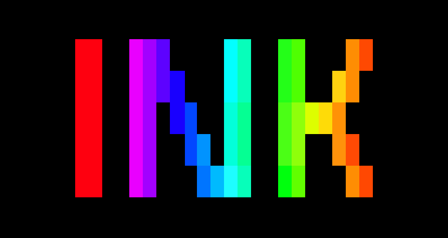

<div align="center"><a name="readme-top"></a>




<h1>Lobe CLI UI</h1>

Ink components shared by the Lobe CLIs. Published as `@lobehub/cli-ui`; inside this monorepo the CLIs still bundle it from `workspace:*` at build time.

[![][github-releasedate-shield]][github-releasedate-link]
[![][github-action-test-shield]][github-action-test-link]
[![][github-action-release-shield]][github-action-release-link]<br/>
[![][github-contributors-shield]][github-contributors-link]
[![][github-forks-shield]][github-forks-link]
[![][github-stars-shield]][github-stars-link]
[![][github-issues-shield]][github-issues-link]
[![][github-license-shield]][github-license-link]

[Changelog](./CHANGELOG.md) · [Report Bug][github-issues-link] · [Request Feature][github-issues-link]


</div>

<details>
<summary><kbd>Table of contents</kbd></summary>

#### TOC

- [📦 Installation](#-installation)
- [⌨️ Local Development](#️-local-development)
- [🤝 Contributing](#-contributing)
- [🔗 Links](#-links)

####

</details>

## 📦 Installation

```bash
# npm / pnpm / yarn (peer: ink, react)
pnpm add @lobehub/cli-ui ink react
```

Inside this monorepo the CLIs still use `workspace:*` and bundle the package at build time. Library artifacts build to `lib/` (`pnpm --filter @lobehub/cli-ui build`); the docs site continues to use `dist/`.

> Registry note: `@lobehub/cli-ui@1.13.0` already exists on npm from an older toolchain. The next `multi-semantic-release` on `master` must bump past `1.13.0` before consumers get this package shape.

<div align="right">

[![][back-to-top]](#readme-top)

</div>

## ⌨️ Local Development

You can use Github Codespaces for online development:

[![][github-codespace-shield]][github-codespace-link]

Or clone it for local development:

```bash
$ git clone https://github.com/lobehub/lobe-cli-toolbox.git
$ cd lobe-cli-toolbox
$ bun install
$ cd packages/lobe-cli-ui
$ bun dev
```

<div align="right">

[![][back-to-top]](#readme-top)

</div>

## 🤝 Contributing

Contributions of all types are more than welcome, if you are interested in contributing code, feel free to check out our GitHub [Issues][github-issues-link] to get stuck in to show us what you’re made of.

[![][pr-welcome-shield]][pr-welcome-link]

[![][github-contrib-shield]][github-contrib-link]

<div align="right">

[![][back-to-top]](#readme-top)

</div>

## 🔗 Links

- 🤯 [LobeHub](https://github.com/lobehub/lobehub) - Chief Agent Operator for hiring, scheduling, and reporting on your AI team
- 🍭 [Lobe UI](https://github.com/lobehub/lobe-ui) - React component library for AI apps
- 🥨 [Lobe Icons](https://github.com/lobehub/lobe-icons) - AI / LLM brand logos and icons
- 📊 [Lobe Charts](https://github.com/lobehub/lobe-charts) - React chart components
- 🖋️ [Lobe Editor](https://github.com/lobehub/lobe-editor) - Lexical-based rich text editor for React, with Markdown, plugins and a chat composer
- 📖 [Docs Kit](https://github.com/lobehub/docs-kit) - Reusable documentation toolkit and lobedocs CLI for LobeHub component libraries
- 🌊 [Streamdown](https://github.com/lobehub/streamdown) - Headless streaming markdown engine for React

<div align="right">

[![][back-to-top]](#readme-top)

</div>

---

#### 📝 License

Copyright © 2023 [LobeHub][profile-link]. <br />
This project is [MIT](./LICENSE) licensed.

<!-- LINK GROUP -->

[back-to-top]: https://img.shields.io/badge/-BACK_TO_TOP-151515?style=flat-square
[github-action-release-link]: https://github.com/lobehub/lobe-cli-toolbox/actions/workflows/release.yml
[github-action-release-shield]: https://img.shields.io/github/actions/workflow/status/lobehub/lobe-cli-toolbox/release.yml?label=release&labelColor=black&logo=githubactions&logoColor=white&style=flat-square
[github-action-test-link]: https://github.com/lobehub/lobe-cli-toolbox/actions/workflows/test.yml
[github-action-test-shield]: https://img.shields.io/github/actions/workflow/status/lobehub/lobe-cli-toolbox/test.yml?label=test&labelColor=black&logo=githubactions&logoColor=white&style=flat-square
[github-codespace-link]: https://codespaces.new/lobehub/lobe-cli-toolbox
[github-codespace-shield]: https://github.com/codespaces/badge.svg
[github-contrib-link]: https://github.com/lobehub/lobe-cli-toolbox/graphs/contributors
[github-contrib-shield]: https://contrib.rocks/image?repo=lobehub%2Flobe-cli-toolbox
[github-contributors-link]: https://github.com/lobehub/lobe-cli-toolbox/graphs/contributors
[github-contributors-shield]: https://img.shields.io/github/contributors/lobehub/lobe-cli-toolbox?color=c4f042&labelColor=black&style=flat-square
[github-forks-link]: https://github.com/lobehub/lobe-cli-toolbox/network/members
[github-forks-shield]: https://img.shields.io/github/forks/lobehub/lobe-cli-toolbox?color=8ae8ff&labelColor=black&style=flat-square
[github-issues-link]: https://github.com/lobehub/lobe-cli-toolbox/issues
[github-issues-shield]: https://img.shields.io/github/issues/lobehub/lobe-cli-toolbox?color=ff80eb&labelColor=black&style=flat-square
[github-license-link]: https://github.com/lobehub/lobe-cli-toolbox/blob/master/LICENSE
[github-license-shield]: https://img.shields.io/github/license/lobehub/lobe-cli-toolbox?color=white&labelColor=black&style=flat-square
[github-releasedate-link]: https://github.com/lobehub/lobe-cli-toolbox/releases
[github-releasedate-shield]: https://img.shields.io/github/release-date/lobehub/lobe-cli-toolbox?labelColor=black&style=flat-square
[github-stars-link]: https://github.com/lobehub/lobe-cli-toolbox/network/stargazers
[github-stars-shield]: https://img.shields.io/github/stars/lobehub/lobe-cli-toolbox?color=ffcb47&labelColor=black&style=flat-square
[pr-welcome-link]: https://github.com/lobehub/lobe-cli-toolbox/pulls
[pr-welcome-shield]: https://img.shields.io/badge/%F0%9F%A4%AF%20PR%20WELCOME-%E2%86%92-ffcb47?labelColor=black&style=for-the-badge
[profile-link]: https://github.com/lobehub
