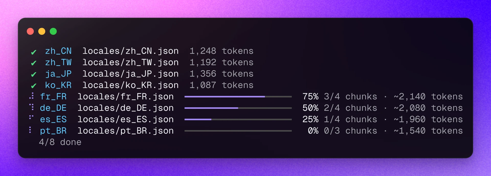

<div align="center"><a name="readme-top"></a>


<h1>Lobe i18n</h1>

Lobe i18n is a CLI workflow tool that uses ChatGPT for automated i18n.

English ・ [简体中文](./README.zh-CN.md) ・ [Changelog](./CHANGELOG.md) · [Report Bug][issues-url] · [Request Feature][issues-url]

<!-- SHIELD GROUP -->

[![][npm-release-shield]][npm-release-link]
[![][github-releasedate-shield]][github-releasedate-link]
[![][github-action-test-shield]][github-action-test-link]
[![][github-action-release-shield]][github-action-release-link]<br/>
[![][github-contributors-shield]][github-contributors-link]
[![][github-forks-shield]][github-forks-link]
[![][github-stars-shield]][github-stars-link]
[![][github-issues-shield]][github-issues-link]
[![][github-license-shield]][github-license-link]



</div>

<details>
<summary><kbd>Table of Contents</kbd></summary>

#### TOC

- [✨ Features](#-features)
- [📦 Installation](#-installation)
- [🤯 Usage](#-usage)
  - [Step 1: Initialize Configuration](#step-1-initialize-configuration)
  - [Step 2: Run Translation Commands](#step-2-run-translation-commands)
  - [AI Agent Skill](#ai-agent-skill)
  - [Configuration](#configuration)
  - [Environment Variable](#environment-variable)
- [🌏 Locale Configuration](#-locale-configuration)
  - [File Structure Selection](#file-structure-selection)
  - [Running](#running)
- [📝 Markdown Configuration](#-markdown-configuration)
  - [File Structure](#file-structure)
  - [Running](#running-1)
- [⌨️ Local Development](#️-local-development)
- [🤝 Contributing](#-contributing)
- [🔗 Links](#-links)

####

</details>

## ✨ Features

- [x] 🤖 Utilize ChatGPT for automated i18n translation
- [x] ✂️ Support automatic splitting of large files without worrying about ChatGPT token limits.
- [x] ♻️ Support incremental i18n updates, automatically extract new content based on `entry` files.
- [x] 🗂️ Support single file mode `en_US.json` and folder mode `en_US/common.json` to work perfectly with `i18next`.
- [x] 🌲 Support `flat` and `tree` structure for locale files.
- [x] 🛠️ Support customizing OpenAI models, API proxies, temperature and topP.
- [x] 📝 Support automated i18n translation of `Markdown` files.
- [x] 🔍 Support linting translation files for language correctness using eld.
- [x] ⚡️ Translate all files and locales in parallel under one shared request limit.
- [x] 🎯 Validate every translation: missing keys and broken placeholders / tags (`{{name}}`, `{count}`, `<0>`) are retried, and never written to disk.
- [x] 📚 Keep terminology consistent with a `glossary` and with the existing translations of each target file.

<div align="right">

[![][back-to-top]](#readme-top)

</div>

## 📦 Installation

To install Lobe i18n, run the following command:

```bash
npm install -g @lobehub/i18n-cli
```

> \[!IMPORTANT]\
> Please make sure you have `Node.js` version **>= 22**.

<div align="right">

[![][back-to-top]](#readme-top)

</div>

## 🤯 Usage

### Step 1: Initialize Configuration

To initialize the Lobe i18n configuration, run the following command:

```shell
$ lobe-i18n -o # or use the full flag --option
```

### Step 2: Run Translation Commands

This command will guide you through creating a configuration file step by step.

Alternatively, you can manually create a configuration file in one of the formats supported by [cosmiconfig](https://github.com/cosmiconfig/cosmiconfig) (see [Configuration](#configuration) below).

Here's an example of a configuration file (`.i18nrc.js`):\
This example demonstrates how to generate `locales/zh_CN.json` and `locales/ja_JP.json` automatically based on `locales/en_US.json`.

```javascript
const { defineConfig } = require('@lobehub/i18n-cli');

module.exports = defineConfig({
  entry: 'locales/en_US.json',
  entryLocale: 'en_US',
  output: 'locales',
  outputLocales: ['zh_CN', 'ja_JP'],
});
```

> \[!IMPORTANT]\
> To use AI auto-generation, run `lobe-i18n -o` to pick a provider, API protocol, base URL, API key and model, or set the `LOBE_*` environment variables below.

```shell
# Translate Locale files
$ lobe-i18n # or $ lobe-i18n locale

# Translate Markdown files
$ lobe-i18n md

# Ignore the markdown cache and retranslate all markdown files
$ lobe-i18n md --force

# Lint translation files for language correctness
$ lobe-i18n lint # or $ lobe-i18n --lint

# Run i18n translation and markdown translation simultaneously
$ lobe-i18n --with-md

# Specify the configuration file
$ lobe-i18n -c './custom-config.js' # or use the full flag --config
```

<br/>

### AI Agent Skill

Install the `lobe-i18n` skill so coding agents (Claude Code, Cursor, Codex, Copilot...) know how to use it:

```shell
$ lobe-i18n skill                # project: .agents/skills, plus .claude/skills if .claude exists
$ lobe-i18n skill --global       # home directory
$ lobe-i18n skill --agent claude # only .claude/skills (agents / claude)
```

Configs written by older versions are migrated automatically the next time any `lobe-i18n` command runs.

<br/>

### Configuration

You can choose any configuration method in [cosmiconfig](https://github.com/cosmiconfig/cosmiconfig) format

- `i18n` property in `package.json`
- `.i18nrc` file in JSON or YAML format
- `.i18nrc.json`, `.i18nrc.yaml`, `.i18nrc.yml`, `.i18nrc.js`, `.i18nrc.cjs`
- `defineConfig` provides a secure definition method that can be imported from `@lobehub/i18n-cli`

> \[!TIP]
>
> This project provides a secure definition method `defineConfig` that can be imported from `@lobehub/i18n-cli`

<br/>

### Environment Variable

This project provides some additional configuration items set with environment variables:

| Environment Variable | Required | Description                                                                                                                                                                                                               | Example                                                                   |
| -------------------- | -------- | ------------------------------------------------------------------------------------------------------------------------------------------------------------------------------------------------------------------------- | ------------------------------------------------------------------------- |
| `LOBE_PROVIDER`      | No       | Provider preset, overrides `lobe-i18n --option`: `openai` `anthropic` `google` `deepseek` `qwen` `moonshot` `zhipu` `minimax` `openrouter` `siliconflow` `volcengine` `groq` `xai` `mistral` `ollama` `lmstudio` `custom` | `deepseek`                                                                |
| `LOBE_API_TYPE`      | No       | API protocol: `chat-completions` (`/v1/chat/completions`), `responses` (`/v1/responses`), `anthropic` (`/v1/messages`), `gemini`                                                                                          | `anthropic`                                                               |
| `LOBE_BASE_URL`      | No       | API base URL                                                                                                                                                                                                              | `https://api.deepseek.com/anthropic`                                      |
| `LOBE_API_KEY`       | No       | API key. Presets also read their own variable, e.g. `ANTHROPIC_API_KEY` `GEMINI_API_KEY` `DEEPSEEK_API_KEY` `DASHSCOPE_API_KEY` `OPENROUTER_API_KEY`. Not needed for `ollama` / `lmstudio`                                | `sk-xxxxxx...xxxxxx`                                                      |
| `OPENAI_API_KEY`     | No       | Legacy: used with `OPENAI_PROXY_URL` when no provider is configured (OpenAI Chat Completions compatible)                                                                                                                  | `sk-xxxxxx...xxxxxx`                                                      |
| `OPENAI_PROXY_URL`   | No       | Legacy: OpenAI compatible base URL                                                                                                                                                                                        | `https://api.chatanywhere.cn/v1`<br/>Default: `https://api.openai.com/v1` |

<div align="right">

[![][back-to-top]](#readme-top)

</div>

## 🌏 Locale Configuration

| Property Name     | Required | Type           | Default Value    | Description                                                                                                          |
| ----------------- | -------- | -------------- | ---------------- | -------------------------------------------------------------------------------------------------------------------- |
| entry             | `*`      | `string`       | -                | Entry file or folder                                                                                                 |
| entryLocale       | `*`      | `string`       | -                | Language to use as translation reference                                                                             |
| modelName         |          | `string`       | provider default | Overrides the model chosen by `lobe-i18n --option`, e.g. `gpt-5-mini` `claude-sonnet-4-5` `deepseek-chat`            |
| output            | `*`      | `string`       | -                | Location to store localized files                                                                                    |
| outputLocales     | `*`      | `string[]  `   | `[]`             | All the languages to be translated                                                                                   |
| keyStyle          |          | `string`       | `nested`         | How to resolve dotted keys: `nested`, `flat`, or `auto` (preserve entry)                                             |
| reference         |          | `string`       | -                | Provide some context for more accurate translations                                                                  |
| referenceExamples |          | `number`       | `20`             | Existing translations of the target file sent as terminology / style examples per chunk, `0` disables it             |
| glossary          |          | `object`       | -                | Fixed term translations, e.g. `{ LobeHub: 'LobeHub', agent: { 'zh-CN': '助手' } }`; a string applies to every locale |
| saveImmediately   |          | `boolean`      | `true`           | Save translation results immediately after each chunk is completed                                                   |
| splitToken        |          | `number`       | `4000`           | Split the localized JSON file by tokens. Large chunks may exceed the max output tokens of the model                  |
| temperature       |          | `number`       | `0`              | Sampling temperature to use                                                                                          |
| topP              |          | `number`       | `1`              | Nucleus sampling threshold, controls the diversity of generated text                                                 |
| concurrency       |          | `number`       | `5`              | Maximum parallel LLM requests, shared across all files and locales                                                   |
| experimental      |          | `experimental` | `{}`             | Experimental features, see below                                                                                     |
| inline            |          | `inline`       | -                | JSON files that keep every locale side by side, see [Inline Structure](#inline-structure)                            |
| markdown          |          | `markdown`     | `{}`             | See `markdown` configuration below                                                                                   |

#### `experimental`

| Property Name | Required | Type      | Default Value | Description                                                                                   |
| ------------- | -------- | --------- | ------------- | --------------------------------------------------------------------------------------------- |
| jsonMode      |          | `boolean` | `false`       | Enable gpt force JSON output for stability (only supported by new models after November 2023) |

<br/>

#### Example 1 `.i18nrc.js`

```js
const { defineConfig } = require('@lobehub/i18n-cli');

module.exports = defineConfig({
  entry: 'locales/en_US.json',
  entryLocale: 'en_US',
  output: 'locales',
  outputLocales: ['zh_CN', 'ja_JP'],
});
```

#### Example 2 `.i18nrc.json`

```json
{
  "entry": "locales/en_US.json",
  "entryLocale": "en_US",
  "output": "locales",
  "outputLocales": ["zh_CN", "ja_JP"]
}
```

#### Example 3 `package.json`

```json
{
  "...": "...",
  "i18n": {
    "entry": "locales/en_US.json",
    "entryLocale": "en_US",
    "output": "locales",
    "outputLocales": ["zh_CN", "ja_JP"]
  }
}
```

#### Example 4 - Enable Immediate Save

```js
const { defineConfig } = require('@lobehub/i18n-cli');

module.exports = defineConfig({
  entry: 'locales/en_US.json',
  entryLocale: 'en_US',
  output: 'locales',
  outputLocales: ['zh_CN', 'ja_JP'],
  saveImmediately: true, // Save results immediately after each chunk completes
  concurrency: 5,
  temperature: 0.3,
});
```

> \[!TIP]
>
> Enabling `saveImmediately` allows you to see translation progress in real-time and provides better fault tolerance. If the translation process is interrupted, completed chunks won't be lost.

<div align="right">

[![][back-to-top]](#readme-top)

</div>

### File Structure Selection

There are three types of file structures supported: `flat`, `tree` and `inline`.

#### Flat Structure

A flat structure means that all translations for different languages are stored in a single file, as shown below:

```
- locales
  - en_US.json
  - ja_JP.json
  - zh_CN.json
  - ...
```

> \[!TIP]
>
> The `flat structure` requires configuring the `entry` property in the configuration file to the corresponding JSON file [Example](./examples/locale/flat/.i18nrc.cjs)

```json
{
  "entry": "locales/en.json",
  "entryLocale": "en_US",
  "output": "locales",
  "outputLocales": ["zh_CN", "ja_JP"]
}
```

#### Tree Structure

A tree structure means that the translations for each language are stored in separate language folders, as shown below:

```
- locales
  - en_US
    - common.json
    - header.json
    - subfolder
      - ...
  - ja_JP
    - common.json
    - header.json
    - subfolder
      - ...
  - zh_CN
    - common.json
    - header.json
    - subfolder
      - ...
```

> \[!TIP]
>
> The `tree structure` requires configuring the `entry` property in the configuration file to the corresponding folder [Example](./examples/locale/tree/.i18nrc.cjs)

```json
{
  "entry": "locales/en_US",
  "entryLocale": "en_US",
  "output": "locales",
  "outputLocales": ["zh_CN", "ja_JP"]
}
```

#### Inline Structure

An inline structure keeps every language in the same JSON file, next to the content it belongs to. An object whose keys are all locales (`entryLocale` plus `outputLocales`) and include `entryLocale` is a locale node. It can be the whole file or sit at any depth, and its value can be a string, an object or an array:

```jsonc
// content/chips/gpu/quiz.json
{
  "zh": [{ "q": "HBM 的作用是什么？", "opts": ["提供显存带宽", "存训练数据"], "ok": 0 }],
  "en": [{ "q": "What does HBM do?", "opts": ["Provide memory bandwidth", "Store training data"], "ok": 0 }]
}

// content/curriculum.json
{
  "layers": [{ "code": "L4", "name": { "zh": "算力", "en": "Compute" }, "dirs": ["chips"] }]
}
```

Each run fills in what is missing for every output locale and leaves the rest of the file alone. Strings that are already translated are kept. Numbers, booleans and `copyKeys` values are copied from the entry locale, and keys removed from the entry locale are removed. An array whose length no longer matches the entry locale is translated again as a whole.

| Property Name | Required | Type       | Default | Description                                                                                |
| ------------- | -------- | ---------- | ------- | ------------------------------------------------------------------------------------------ |
| entry         | `*`      | `string[]` | -       | JSON files to translate, supports `glob`                                                   |
| exclude       |          | `string[]` | `[]`    | Files to skip, supports `glob`                                                             |
| copyKeys      |          | `string[]` | `[]`    | Keys whose values are identifiers rather than text (`id`, `kind`), copied as is, any depth |

`entry` and `output` can be left out when the project only uses inline files:

```js
const { defineConfig } = require('@lobehub/i18n-cli');

module.exports = defineConfig({
  entryLocale: 'zh',
  outputLocales: ['en'],
  inline: {
    entry: ['content/**/*.json'],
    exclude: ['content/index.json'],
    copyKeys: ['id', 'kind'],
  },
});
```

> \[!NOTE]
>
> Changed files are written with 2-space `JSON.stringify` formatting and keep their key order, so run your formatter (e.g. Prettier) afterwards if it formats JSON differently. Like the other structures, a changed source string is not retranslated; delete the translation to retranslate it.

### Running

Use the `lobe-i18n` command to generate i18n files automatically:

```shell
$ lobe-i18n
```

<div align="right">

[![][back-to-top]](#readme-top)

</div>

## 📝 Markdown Configuration

| Property Name    | Required | Type                        | Default                      | Description                                                              |
| ---------------- | -------- | --------------------------- | ---------------------------- | ------------------------------------------------------------------------ |
| entry            | `*`      | `string[]`                  | `[]`                         | Entry file or folder, supports `glob`                                    |
| entryLocale      |          | `string`                    | _Inherit parent locale_      | Reference language for translation                                       |
| entryExtension   |          | `string`                    | `.md`                        | Entry file extension                                                     |
| exclude          |          | `string[]`                  | `[]`                         | Files to be filtered, supports `glob`                                    |
| outputLocales    |          | `string[]`                  | _Inherit parent locale_      | All languages to be translated                                           |
| outputExtensions |          | `function`                  | `(locale) => '.{locale}.md'` | Output file extension generation                                         |
| mode             |          | `string`,`mdast`,`function` | `string`                     | Translation mode selection, explained below                              |
| translateCode    |          | `boolean`                   | `false`                      | Whether to translate code blocks under `mdast`, other modes are invalid  |
| includeMatter    |          | `boolean`                   | `false`                      | Whether to include front matter in the translation                       |
| matterKeys       |          | `string[]`                  | `[]`                         | Front matter keys to translate when `includeMatter` is off, e.g. `title` |
| cacheFile        |          | `string`                    | `.i18n-cache.json`           | File storing source hashes, used to retranslate changed markdown         |

#### Markdown cache

Each translated file records the hash of its source markdown in `cacheFile`. When the source changes, the outdated translations are retranslated automatically; unchanged ones are skipped. Existing translations without a cache entry are trusted as up to date on the first run. Commit the cache file to share it with your team and CI, and use `--force` to retranslate everything.

#### `outputExtensions`

By default, the translated file names are generated as `.{locale}.md`. You can customize the output file extensions with `outputExtensions`.

> \[!NOTE]
>
> In the example below, the entry file extension is `.zh-CN.md`, but we want the output file extension for the `en-US` translation to be `.md`, while other languages keep the default extensions.

```js
module.exports = {
  markdown: {
    entry: ['./README.zh-CN.md', './docs/**/*.zh-CN.md'],
    entryLocale: 'zh-CN',
    entryExtension: '.zh-CN.md',
    outputLocales: ['en-US', 'ja-JP'],
    outputExtensions: (locale, { getDefaultExtension }) => {
      if (locale === 'en-US') return '.md';
      return getDefaultExtension(locale);
    },
  },
};
```

> `outputExtensions` supports the following `props`:

```ts
interface OutputExtensionsProps {
  /**
   * @description The locale of the translated file to output
   */
  locale: string;
  config: {
    /**
     * @description The content of the translated file to input
     */
    fileContent: string;
    /**
     * @description The path of the translated file to input
     */
    filePath: string;
    /**
     * @description The default method for generating extensions
     */
    getDefaultExtension: (locale: string) => string;
  };
}
```

#### `mode`

`mode` is used to specify the translation mode, which supports two modes and custom generation modes.

- `string` - Translates the complete `markdown` content.
- `mdast` - Parses the text with `mdast` structure and translates the `text value` content. To translate code blocks, you need to enable `translateCode`.

> \[!WARNING]
>
> In `mdast` mode, the content to be translated will be reduced to a minimum, removing most markdown syntax structures and links.
> This mode can greatly reduce token consumption, but it may result in inaccurate translation results.

<div align="right">

[![][back-to-top]](#readme-top)

</div>

### File Structure

The translated files will be generated in the same directory as the entry file, with the corresponding language suffix added to the extension:

```
- README.md
- README.zh-CN.md
	- docs
		- usage.md
		- usage.zh-CN.md
		- subfolder
            - ...
```

> \[!TIP]
>
> [Example](./examples/markdown/.i18nrc.cjs)

### Running

Use the `lobe-i18n md` command to automate the generation of i18n files:

```shell
$ lobe-i18n md
```

<div align="right">

[![][back-to-top]](#readme-top)

</div>

## ⌨️ Local Development

You can use Github Codespaces for online development:

[![][github-codespace-shield]][github-codespace-link]

Alternatively, you can clone the repository and run the following command for local development:

[![][bun-shield]][bun-link]

```bash
$ git clone https://github.com/lobehub/lobe-cli-toolbox.git
$ cd lobe-cli-toolbox
$ bun install
$ cd packages/lobe-i18n
$ bun dev
```

<div align="right">

[![][back-to-top]](#readme-top)

</div>

## 🤝 Contributing

We welcome contributions in all forms. If you're interested in contributing code, you can check our GitHub [Issues][github-issues-link], show off your skills, and demonstrate your ideas.

[![][pr-welcome-shield]][pr-welcome-link]

[![][github-contrib-shield]][github-contrib-link]

<div align="right">

[![][back-to-top]](#readme-top)

</div>

## 🔗 Links

- **[LobeHub](https://github.com/lobehub/lobehub)**
- **[lobe ui](https://github.com/lobehub/lobe-ui)**
- **[lobe icons](https://github.com/lobehub/lobe-icons)**
- **[lobe charts](https://github.com/lobehub/lobe-charts)**
- **[lobe editor](https://github.com/lobehub/lobe-editor)**
- **[docs kit](https://github.com/lobehub/docs-kit)**
- **[stream down](https://github.com/lobehub/streamdown)**

<div align="right">

[![][back-to-top]](#readme-top)

</div>

---

#### 📝 License

Copyright © 2023 [LobeHub][profile-link]. <br />
This project is licensed under the [MIT](./LICENSE) license.

<!-- LINK GROUP -->

[back-to-top]: https://img.shields.io/badge/-BACK_TO_TOP-151515?style=flat-square
[bun-link]: https://bun.sh
[bun-shield]: https://img.shields.io/badge/-speedup%20with%20bun-black?logo=bun&style=for-the-badge
[github-action-release-link]: https://github.com/lobehub/lobe-cli-toolbox/actions/workflows/release.yml
[github-action-release-shield]: https://img.shields.io/github/actions/workflow/status/lobehub/lobe-cli-toolbox/release.yml?label=release&labelColor=black&logo=githubactions&logoColor=white&style=flat-square
[github-action-test-link]: https://github.com/lobehub/lobe-cli-toolbox/actions/workflows/test.yml
[github-action-test-shield]: https://img.shields.io/github/actions/workflow/status/lobehub/lobe-cli-toolbox/test.yml?label=test&labelColor=black&logo=githubactions&logoColor=white&style=flat-square
[github-codespace-link]: https://codespaces.new/lobehub/lobe-cli-toolbox
[github-codespace-shield]: https://github.com/codespaces/badge.svg
[github-contrib-link]: https://github.com/lobehub/lobe-cli-toolbox/graphs/contributors
[github-contrib-shield]: https://contrib.rocks/image?repo=lobehub%2Flobe-cli-toolbox
[github-contributors-link]: https://github.com/lobehub/lobe-cli-toolbox/graphs/contributors
[github-contributors-shield]: https://img.shields.io/github/contributors/lobehub/lobe-cli-toolbox?color=c4f042&labelColor=black&style=flat-square
[github-forks-link]: https://github.com/lobehub/lobe-cli-toolbox/network/members
[github-forks-shield]: https://img.shields.io/github/forks/lobehub/lobe-cli-toolbox?color=8ae8ff&labelColor=black&style=flat-square
[github-issues-link]: https://github.com/lobehub/lobe-cli-toolbox/issues
[github-issues-shield]: https://img.shields.io/github/issues/lobehub/lobe-cli-toolbox?color=ff80eb&labelColor=black&style=flat-square
[github-license-link]: https://github.com/lobehub/lobe-cli-toolbox/blob/master/LICENSE
[github-license-shield]: https://img.shields.io/github/license/lobehub/lobe-cli-toolbox?color=white&labelColor=black&style=flat-square
[github-releasedate-link]: https://github.com/lobehub/lobe-cli-toolbox/releases
[github-releasedate-shield]: https://img.shields.io/github/release-date/lobehub/lobe-cli-toolbox?labelColor=black&style=flat-square
[github-stars-link]: https://github.com/lobehub/lobe-cli-toolbox/network/stargazers
[github-stars-shield]: https://img.shields.io/github/stars/lobehub/lobe-cli-toolbox?color=ffcb47&labelColor=black&style=flat-square
[issues-url]: https://github.com/canisminor1990/lobe-commit/issues/new/choose
[npm-release-link]: https://www.npmjs.com/package/@lobehub/i18n-cli
[npm-release-shield]: https://img.shields.io/npm/v/@lobehub/i18n-cli?color=369eff&labelColor=black&logo=npm&logoColor=white&style=flat-square
[pr-welcome-link]: https://github.com/lobehub/lobe-cli-toolbox/pulls
[pr-welcome-shield]: https://img.shields.io/badge/%F0%9F%A4%AF%20PR%20WELCOME-%E2%86%92-ffcb47?labelColor=black&style=for-the-badge
[profile-link]: https://github.com/lobehub
