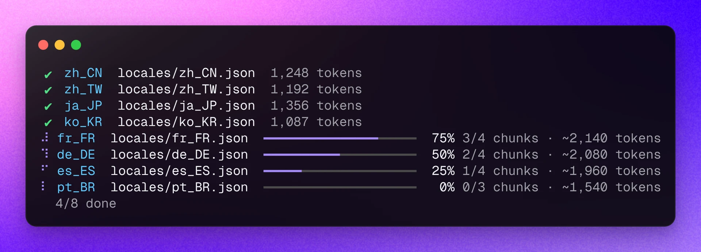

<div align="center"><a name="readme-top"></a>


<h1>Lobe i18n</h1>

Lobe i18n 是一款使用 ChatGPT 自动化 i18n 的 CLI 流程工具

[English](./README.md) ・ 简体中文 ・ [Changelog](./CHANGELOG.md) · [Report Bug][issues-url] · [Request Feature][issues-url]

<!-- SHIELD GROUP -->

[![][npm-release-shield]][npm-release-link]
[![][github-releasedate-shield]][github-releasedate-link]
[![][github-action-test-shield]][github-action-test-link]
[![][github-action-release-shield]][github-action-release-link]<br/>
[![][github-contributors-shield]][github-contributors-link]
[![][github-forks-shield]][github-forks-link]
[![][github-stars-shield]][github-stars-link]
[![][github-issues-shield]][github-issues-link]
[![][github-license-shield]][github-license-link]



</div>

<details>
<summary><kbd>文档目录</kbd></summary>

#### TOC

- [✨ 特性](#-特性)
- [📦 安装](#-安装)
- [🤯 使用](#-使用)
  - [第一步：初始化配置](#第一步初始化配置)
  - [第二步：运行翻译命令](#第二步运行翻译命令)
  - [AI Agent Skill](#ai-agent-skill)
  - [配置](#配置)
  - [环境变量](#环境变量)
- [🌏 Locale 配置](#-locale-配置)
  - [文件结构选择](#文件结构选择)
  - [运行](#运行)
- [📝 Markdown 配置](#-markdown-配置)
  - [文件结构](#文件结构)
  - [运行](#运行-1)
- [⌨️ 本地开发](#️-本地开发)
- [🤝 参与贡献](#-参与贡献)
- [🔗 链接](#-链接)

####

</details>

## ✨ 特性

- [x] 🤖 利用 ChatGPT 实现 i18n 翻译自动化
- [x] ✂️ 支持大型文件自动分割，不必担心 ChatGPT token 限制
- [x] ♻️ 支持 i18n 增量更新，按照 `entry` 文件自动提取新增内容
- [x] 🗂️ 支持单文件模式 `en_US.json` 和文件夹 `en_US/common.json` 模式，完美配合 `i18next` 使用
- [x] 🌲 支持 `扁平` 和 `树状` locale 文件
- [x] 🛠️ 支持自定义 OpenAI 模型、API 代理、temperature、topP
- [x] 📝 支持 `Markdown` i18n 翻译自动化
- [x] ⚡️ 所有文件与语言并行翻译，共享同一个请求并发上限
- [x] 🎯 校验每条译文：缺失的键、被破坏的占位符 / 标签（`{{name}}`、`{count}`、`<0>`）会自动重试，且不会写入文件
- [x] 📚 通过 `glossary` 术语表和目标文件中已有的译文保持术语一致

<div align="right">

[![][back-to-top]](#readme-top)

</div>

## 📦 安装

要安装 Lobe i18n，请运行以下命令：

```bash
npm install -g @lobehub/i18n-cli
```

> \[!IMPORTANT]\
> 请确保环境中 `Node.js` 版本 **>= 22**

<div align="right">

[![][back-to-top]](#readme-top)

</div>

## 🤯 使用

### 第一步：初始化配置

要初始化配置 Lobe i8n，请运行以下命令：

```shell
$ lobe-i18n -o # 或使用完整标志 --option
```

### 第二步：运行翻译命令

此命令将引导您逐步创建配置文件。

或者，您可以手动创建配置文件，支持的格式请参考 [cosmiconfig](https://github.com/cosmiconfig/cosmiconfig) （详见 [Configuration](#configuration)）。

以下是一个配置文件示例（`.i18nrc.js`）：\
此示例展示了如何基于 `locales/en_US.json` 自动生成 `locales/zh_CN.json` 和 `locales/ja_JP.json`。

```javascript
const { defineConfig } = require('@lobehub/i18n-cli');

module.exports = defineConfig({
  entry: 'locales/en_US.json',
  entryLocale: 'en_US',
  output: 'locales',
  outputLocales: ['zh_CN', 'ja_JP'],
});
```

> \[!IMPORTANT]\
> 要使用 AI 自动生成，请运行 `lobe-i18n -o` 选择供应商、接口协议、API 地址、API 密钥和模型，或设置下方的 `LOBE_*` 环境变量

```shell
# 翻译 Locale 文件
$ lobe-i18n
## or
$ lobe-i18n locale

# 翻译 Markdown 文件
$ lobe-i18n md

# 忽略 Markdown 缓存，重新翻译所有 Markdown 文件
$ lobe-i18n md --force

# Lint 校验翻译文件语言正确性
$ lobe-i18n lint

# 同时运行 i18n 翻译和 markdown 翻译
$ lobe-i18n --with-md

# 指定配置文件
$ lobe-i18n -c './custom-config.js' # or use the full flag --config
```

<br/>

### AI Agent Skill

安装 `lobe-i18n` skill，让 Claude Code、Cursor、Codex、Copilot 等编程 Agent 知道如何使用它：

```shell
$ lobe-i18n skill                # 当前项目：.agents/skills，存在 .claude 时同时安装到 .claude/skills
$ lobe-i18n skill --global       # 安装到用户目录
$ lobe-i18n skill --agent claude # 只安装到 .claude/skills（可选 agents / claude）
```

旧版本写入的配置会在下次运行任意 `lobe-i18n` 命令时自动迁移到新格式。

<br/>

### 配置

可以按照 [cosmiconfig](https://github.com/cosmiconfig/cosmiconfig) 格式任选配置方式

- `package.json` 中的 `i18n` 属性
- 以 JSON 或 YAML 格式的 `.i18nrc` 文件
- `.i18nrc.json`、`.i18nrc.yaml`、`.i18nrc.yml`、`.i18nrc.js`、`.i18nrc.cjs` 文件

> \[!TIP]
>
> 本项目提供了 `defineConfig` 安全定义方法可以从 `@lobehub/i18n-cli` 中导入

<br/>

### 环境变量

本项目提供了一些额外的配置项，使用环境变量进行设置：

| 环境变量           | 类型 | 描述                                                                                                                                                                                                                       | 示例                                                                     |
| ------------------ | ---- | -------------------------------------------------------------------------------------------------------------------------------------------------------------------------------------------------------------------------- | ------------------------------------------------------------------------ |
| `LOBE_PROVIDER`    | 可选 | 供应商预设，优先于 `lobe-i18n --option` 中的配置：`openai` `anthropic` `google` `deepseek` `qwen` `moonshot` `zhipu` `minimax` `openrouter` `siliconflow` `volcengine` `groq` `xai` `mistral` `ollama` `lmstudio` `custom` | `deepseek`                                                               |
| `LOBE_API_TYPE`    | 可选 | 接口协议：`chat-completions`（`/v1/chat/completions`）、`responses`（`/v1/responses`）、`anthropic`（`/v1/messages`）、`gemini`                                                                                            | `anthropic`                                                              |
| `LOBE_BASE_URL`    | 可选 | API 地址                                                                                                                                                                                                                   | `https://api.deepseek.com/anthropic`                                     |
| `LOBE_API_KEY`     | 可选 | API 密钥。各预设也会读取自己的变量，如 `ANTHROPIC_API_KEY` `GEMINI_API_KEY` `DEEPSEEK_API_KEY` `DASHSCOPE_API_KEY` `OPENROUTER_API_KEY`；`ollama` / `lmstudio` 无需密钥                                                    | `sk-xxxxxx...xxxxxx`                                                     |
| `OPENAI_API_KEY`   | 可选 | 旧版配置：未配置供应商时，与 `OPENAI_PROXY_URL` 一起按 OpenAI Chat Completions 兼容接口使用                                                                                                                                | `sk-xxxxxx...xxxxxx`                                                     |
| `OPENAI_PROXY_URL` | 可选 | 旧版配置：OpenAI 兼容接口地址                                                                                                                                                                                              | `https://api.chatanywhere.cn/v1`<br/>默认值: `https://api.openai.com/v1` |

<div align="right">

[![][back-to-top]](#readme-top)

</div>

## 🌏 Locale 配置

| 属性名称          | 必填 | 类型           | 默认值     | 描述                                                                                          |
| ----------------- | ---- | -------------- | ---------- | --------------------------------------------------------------------------------------------- |
| entry             | `*`  | `string`       | -          | 入口文件或文件夹                                                                              |
| entryLocale       | `*`  | `string`       | -          | 作为翻译参考的语言                                                                            |
| modelName         |      | `string`       | 供应商默认 | 覆盖 `lobe-i18n --option` 中选择的模型，如 `gpt-5-mini` `claude-sonnet-4-5` `deepseek-chat`   |
| output            | `*`  | `string`       | -          | 存储本地化文件的位置                                                                          |
| outputLocales     | `*`  | `string[] `    | `[]`       | 需要进行翻译的所有语言                                                                        |
| keyStyle          |      | `string`       | `nested`   | 处理点分隔键的方式：`nested`、`flat` 或 `auto`（按入口文件）                                  |
| reference         |      | `string`       | -          | 提供一些上下文以获得更准确的翻译                                                              |
| referenceExamples |      | `number`       | `20`       | 每个分块附带的目标文件已有译文数量，用于统一术语和风格，`0` 表示关闭                          |
| glossary          |      | `object`       | -          | 固定术语译法，如 `{ LobeHub: 'LobeHub', agent: { 'zh-CN': '助手' } }`；字符串值对所有语言生效 |
| saveImmediately   |      | `boolean`      | `true`     | 在每个翻译块完成后立即保存翻译结果                                                            |
| splitToken        |      | `number`       | `4000`     | 按令牌分割本地化 JSON 文件，单块过大可能超出模型的最大输出长度                                |
| temperature       |      | `number`       | `0`        | 使用的采样温度                                                                                |
| topP              |      | `number`       | `1`        | 生成过程中的核采样方法概率阈值，取值越大生成的随机性越高                                      |
| concurrency       |      | `number`       | `5`        | LLM 请求的最大并发数，由所有文件和语言共享                                                    |
| experimental      |      | `experimental` | `{}`       | 实验性功能，见下文                                                                            |
| inline            |      | `inline`       | -          | 所有语言写在同一个 JSON 文件里的结构，见 [内联结构](#内联结构)                                |
| markdown          |      | `markdown`     | `{}`       | 见 `markdown` 配置说明                                                                        |

#### `experimental`

| 属性名称 | 必填 | 类型      | 默认值  | 描述                                                           |
| -------- | ---- | --------- | ------- | -------------------------------------------------------------- |
| jsonMode |      | `boolean` | `false` | 开启 gpt 强制 json 输出提升稳定性 (只支持 23 年 11 月后新模型) |

<br/>

#### 示例一 `.i18nrc.js`

```js
const { defineConfig } = require('@lobehub/i18n-cli');

module.exports = defineConfig({
  entry: 'locales/en_US.json',
  entryLocale: 'en_US',
  output: 'locales',
  outputLocales: ['zh_CN', 'ja_JP'],
});
```

#### 示例二 `.i18nrc.json`

```json
{
  "entry": "locales/en_US.json",
  "entryLocale": "en_US",
  "output": "locales",
  "outputLocales": ["zh_CN", "ja_JP"]
}
```

#### 示例三 `package.json`

```json
{
  "...": "...",
  "i18n": {
    "entry": "locales/en_US.json",
    "entryLocale": "en_US",
    "output": "locales",
    "outputLocales": ["zh_CN", "ja_JP"]
  }
}
```

#### 示例四 - 启用立即保存

```js
const { defineConfig } = require('@lobehub/i18n-cli');

module.exports = defineConfig({
  entry: 'locales/en_US.json',
  entryLocale: 'en_US',
  output: 'locales',
  outputLocales: ['zh_CN', 'ja_JP'],
  saveImmediately: true, // 每个翻译块完成后立即保存结果
  concurrency: 5,
  temperature: 0.3,
});
```

> \[!TIP]
>
> 启用 `saveImmediately` 可以让你实时看到翻译进度，并提供更好的容错性。如果翻译过程中断，已完成的翻译块不会丢失。

<div align="right">

[![][back-to-top]](#readme-top)

</div>

### 文件结构选择

支持三种文件结构，分别为 `单文件`、`文件夹` 和 `内联` 结构

#### 单文件结构

单文件结构指的是所有语言的翻译都存储在一个文件中，如下所示：

```
- locales
	- en_US.json
	- ja_JP.json
	- zh_CN.json
	- ...
```

> \[!TIP]
>
> `单文件结构` 需要在配置文件中将 `entry` 配置为对应的 JSON 文件 [示例](./examples/locale/flat/.i18nrc.cjs)

```json
{
  "entry": "locales/en.json",
  "entryLocale": "en_US",
  "output": "locales",
  "outputLocales": ["zh_CN", "ja_JP"]
}
```

**文件夹结构**

文件夹结构指的是每个语言的翻译都存储在对应的语种文件夹中，如下所示：

```
- locales
	- en_US
		- common.json
		- header.json
		- subfolder
            - ...
	- ja_JP
		- common.json
		- header.json
		- subfolder
            - ...
	- zh_CN
		- common.json
		- header.json
		- subfolder
            - ...
```

> \[!TIP]
>
> `文件夹结构` 需要在配置文件中将 `entry` 配置为对应的文件夹 [示例](./examples/locale/tree/.i18nrc.cjs)

```json
{
  "entry": "locales/en_US",
  "entryLocale": "en_US",
  "output": "locales",
  "outputLocales": ["zh_CN", "ja_JP"]
}
```

#### 内联结构

内联结构把所有语言写在同一个 JSON 文件里，和它所属的内容放在一起。如果一个对象的 key 全部是语言（`entryLocale` 加 `outputLocales`），并且包含 `entryLocale`，它就是一个语言节点。语言节点可以是整个文件，也可以在任意深度；值可以是字符串、对象或数组：

```jsonc
// content/chips/gpu/quiz.json
{
  "zh": [{ "q": "HBM 的作用是什么？", "opts": ["提供显存带宽", "存训练数据"], "ok": 0 }],
  "en": [{ "q": "What does HBM do?", "opts": ["Provide memory bandwidth", "Store training data"], "ok": 0 }]
}

// content/curriculum.json
{
  "layers": [{ "code": "L4", "name": { "zh": "算力", "en": "Compute" }, "dirs": ["chips"] }]
}
```

每次运行只补齐各目标语言缺少的内容，文件的其他部分保持不动。已有译文会保留；数字、布尔值和 `copyKeys` 的值从源语言复制；源语言里删掉的 key 也会被删除。数组长度和源语言不一致时，整个数组重新翻译。

| 属性名称 | 必填 | 类型       | 默认值 | 描述                                                            |
| -------- | ---- | ---------- | ------ | --------------------------------------------------------------- |
| entry    | `*`  | `string[]` | -      | 需要翻译的 JSON 文件，支持 `glob`                               |
| exclude  |      | `string[]` | `[]`   | 需要跳过的文件，支持 `glob`                                     |
| copyKeys |      | `string[]` | `[]`   | 值是标识符而不是文本的 key（如 `id`、`kind`），任意深度原样复制 |

如果项目只用内联文件，可以不写 `entry` 和 `output`：

```js
const { defineConfig } = require('@lobehub/i18n-cli');

module.exports = defineConfig({
  entryLocale: 'zh',
  outputLocales: ['en'],
  inline: {
    entry: ['content/**/*.json'],
    exclude: ['content/index.json'],
    copyKeys: ['id', 'kind'],
  },
});
```

> \[!NOTE]
>
> 有改动的文件会按 2 空格的 `JSON.stringify` 格式写回，key 顺序不变。如果项目的格式化工具（如 Prettier）对 JSON 的格式不同，运行后再格式化一次即可。和其他结构一样，源语言的字符串改动后不会自动重译，删除对应译文后再运行即可。

### 运行

使用 `lobe-i18n` 命令自动化生成 i18n 文件：

```shell
$ lobe-i18n
```

<div align="right">

[![][back-to-top]](#readme-top)

</div>

## 📝 Markdown 配置

| 属性名称         | 必填 | 类型                        | 默认值                       | 描述                                                             |
| ---------------- | ---- | --------------------------- | ---------------------------- | ---------------------------------------------------------------- |
| entry            | `*`  | `string[]`                  | `[]`                         | 入口文件或文件夹，支持 `glob`                                    |
| entryLocale      |      | `string`                    | _继承同父级_                 | 作为翻译参考的语言                                               |
| entryExtension   |      | `string`                    | `.md`                        | 入口文件扩展名                                                   |
| exclude          |      | `string[]`                  | `[]`                         | 需要过滤的文件，支持 `glob`                                      |
| outputLocales    |      | `string[]`                  | _继承同父级_                 | 需要进行翻译的所有语言                                           |
| outputExtensions |      | `function`                  | `(locale) => '.{locale}.md'` | 输出文件的扩展名生成                                             |
| mode             |      | `string`,`mdast`,`function` | `string`                     | 翻译的模式选择，解释见下文                                       |
| translateCode    |      | `boolean`                   | `false`                      | 在 `mdast` 下是否翻译代码块，其他模式无效                        |
| includeMatter    |      | `boolean`                   | `false`                      | 是否翻译 `front matter`                                          |
| matterKeys       |      | `string[]`                  | `[]`                         | `includeMatter` 关闭时需要翻译的 `front matter` 字段，如 `title` |
| cacheFile        |      | `string`                    | `.i18n-cache.json`           | 存储源文件 hash 的缓存文件，用于增量翻译                         |

#### Markdown 缓存

每个译文都会在 `cacheFile` 中记录其源 Markdown 的 hash。源文件变更后，过期的译文会自动重新翻译，未变更的则跳过。首次运行时，已存在但没有缓存记录的译文会被视为最新。建议将缓存文件提交到仓库，以便团队和 CI 共享；使用 `--force` 可重新翻译全部文件。

#### `outputExtensions`

默认生成的翻译后文件名为 `.{locale}.md`，可以通过 `outputExtensions` 自定义输出文件扩展名

> \[!NOTE]
>
> 在下方的示意中，入口文件扩展名为 `.zh-CN.md`，但我们希望输出的 `en-US` 翻译文件扩展名为 `.md`, 其他语言保持默认

```js
module.exports = {
  markdown: {
    entry: ['./README.zh-CN.md', './docs/**/*.zh-CN.md'],
    entryLocale: 'zh-CN',
    entryExtension: '.zh-CN.md',
    outputLocales: ['en-US', 'ja-JP'],
    outputExtensions: (locale, { getDefaultExtension }) => {
      if (locale === 'en-US') return '.md';
      return getDefaultExtension(locale);
    },
  },
};
```

> `outputExtensions` 完整支持的 `props` 如下：

```ts
interface OutputExtensionsProps {
  /**
   * @description 输出的翻译文件的语种
   */
  locale: string;
  config: {
    /**
     * @description 输入的翻译文件的内容
     */
    fileContent: string;
    /**
     * @description 输入的翻译文件的路径
     */
    filePath: string;
    /**
     * @description 默认的扩展名生成方法
     */
    getDefaultExtension: (locale: string) => string;
  };
}
```

#### `mode`

`mode` 用于指定翻译的模式，支持二种模式和自定义生成模式

- `string` - 使用完整的 `markdown` 内容进行翻译
- `mdast` - 使用 `mdast` 结构化解析文本，指翻译 `text value` 文本内容，如需翻译代码块，需要开启 `translateCode`

> \[!WARNING]
>
> `mdast` 模式下，将会把需要翻译的内容缩减到最低限度，移除大部分 markdown 语法结构和链接，
> 此模式可大大减少 token 消耗，但是可能会导致翻译结果不准确。

<div align="right">

[![][back-to-top]](#readme-top)

</div>

### 文件结构

翻译后的文件将生成在和入口文件同级的目录下，在扩展名上会添加对应的语种后缀：

```
- README.md
- README.zh-CN.md
	- docs
		- usage.md
		- usage.zh-CN.md
		- subfolder
            - ...
```

> \[!TIP]
>
> [示例](./examples/markdown/.i18nrc.cjs)

### 运行

使用 `lobe-i18n md` 命令自动化生成 i18n 文件：

```shell
$ lobe-i18n md
```

<div align="right">

[![][back-to-top]](#readme-top)

</div>

## ⌨️ 本地开发

可以使用 Github Codespaces 进行在线开发：

[![][github-codespace-shield]][github-codespace-link]

或者，可以克隆存储库并运行以下命令进行本地开发：

[![][bun-shield]][bun-link]

```bash
$ git clone https://github.com/lobehub/lobe-cli-toolbox.git
$ cd lobe-cli-toolbox
$ bun install
$ cd packages/lobe-i18n
$ bun dev
```

<div align="right">

[![][back-to-top]](#readme-top)

</div>

## 🤝 参与贡献

我们非常欢迎各种形式的贡献。如果你对贡献代码感兴趣，可以查看我们的 GitHub [Issues][github-issues-link]，大展身手，向我们展示你的奇思妙想。

[![][pr-welcome-shield]][pr-welcome-link]

[![][github-contrib-shield]][github-contrib-link]

<div align="right">

[![][back-to-top]](#readme-top)

</div>

## 🔗 链接

- **[LobeHub](https://github.com/lobehub/lobehub)**
- **[lobe ui](https://github.com/lobehub/lobe-ui)**
- **[lobe icons](https://github.com/lobehub/lobe-icons)**
- **[lobe charts](https://github.com/lobehub/lobe-charts)**
- **[lobe editor](https://github.com/lobehub/lobe-editor)**
- **[docs kit](https://github.com/lobehub/docs-kit)**
- **[stream down](https://github.com/lobehub/streamdown)**

<div align="right">

[![][back-to-top]](#readme-top)

</div>

---

#### 📝 License

Copyright © 2023 [LobeHub][profile-link]. <br />
This project is [MIT](./LICENSE) licensed.

<!-- LINK GROUP -->

[back-to-top]: https://img.shields.io/badge/-BACK_TO_TOP-151515?style=flat-square
[bun-link]: https://bun.sh
[bun-shield]: https://img.shields.io/badge/-speedup%20with%20bun-black?logo=bun&style=for-the-badge
[github-action-release-link]: https://github.com/lobehub/lobe-cli-toolbox/actions/workflows/release.yml
[github-action-release-shield]: https://img.shields.io/github/actions/workflow/status/lobehub/lobe-cli-toolbox/release.yml?label=release&labelColor=black&logo=githubactions&logoColor=white&style=flat-square
[github-action-test-link]: https://github.com/lobehub/lobe-cli-toolbox/actions/workflows/test.yml
[github-action-test-shield]: https://img.shields.io/github/actions/workflow/status/lobehub/lobe-cli-toolbox/test.yml?label=test&labelColor=black&logo=githubactions&logoColor=white&style=flat-square
[github-codespace-link]: https://codespaces.new/lobehub/lobe-cli-toolbox
[github-codespace-shield]: https://github.com/codespaces/badge.svg
[github-contrib-link]: https://github.com/lobehub/lobe-cli-toolbox/graphs/contributors
[github-contrib-shield]: https://contrib.rocks/image?repo=lobehub%2Flobe-cli-toolbox
[github-contributors-link]: https://github.com/lobehub/lobe-cli-toolbox/graphs/contributors
[github-contributors-shield]: https://img.shields.io/github/contributors/lobehub/lobe-cli-toolbox?color=c4f042&labelColor=black&style=flat-square
[github-forks-link]: https://github.com/lobehub/lobe-cli-toolbox/network/members
[github-forks-shield]: https://img.shields.io/github/forks/lobehub/lobe-cli-toolbox?color=8ae8ff&labelColor=black&style=flat-square
[github-issues-link]: https://github.com/lobehub/lobe-cli-toolbox/issues
[github-issues-shield]: https://img.shields.io/github/issues/lobehub/lobe-cli-toolbox?color=ff80eb&labelColor=black&style=flat-square
[github-license-link]: https://github.com/lobehub/lobe-cli-toolbox/blob/master/LICENSE
[github-license-shield]: https://img.shields.io/github/license/lobehub/lobe-cli-toolbox?color=white&labelColor=black&style=flat-square
[github-releasedate-link]: https://github.com/lobehub/lobe-cli-toolbox/releases
[github-releasedate-shield]: https://img.shields.io/github/release-date/lobehub/lobe-cli-toolbox?labelColor=black&style=flat-square
[github-stars-link]: https://github.com/lobehub/lobe-cli-toolbox/network/stargazers
[github-stars-shield]: https://img.shields.io/github/stars/lobehub/lobe-cli-toolbox?color=ffcb47&labelColor=black&style=flat-square
[issues-url]: https://github.com/canisminor1990/lobe-commit/issues/new/choose
[npm-release-link]: https://www.npmjs.com/package/@lobehub/i18n-cli
[npm-release-shield]: https://img.shields.io/npm/v/@lobehub/i18n-cli?color=369eff&labelColor=black&logo=npm&logoColor=white&style=flat-square
[pr-welcome-link]: https://github.com/lobehub/lobe-cli-toolbox/pulls
[pr-welcome-shield]: https://img.shields.io/badge/%F0%9F%A4%AF%20PR%20WELCOME-%E2%86%92-ffcb47?labelColor=black&style=for-the-badge
[profile-link]: https://github.com/lobehub
