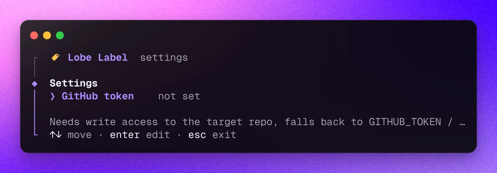

<div align="center"><a name="readme-top"></a>


<h1>Lobe标签</h1>

自动从模板仓库复制 Issues 标签

[![][npm-release-shield]][npm-release-link]
[![][github-releasedate-shield]][github-releasedate-link]
[![][github-action-test-shield]][github-action-test-link]
[![][github-action-release-shield]][github-action-release-link]<br/>
[![][github-contributors-shield]][github-contributors-link]
[![][github-forks-shield]][github-forks-link]
[![][github-stars-shield]][github-stars-link]
[![][github-issues-shield]][github-issues-link]
[![][github-license-shield]][github-license-link]

[English](./README.md) ・ 简体中文 ・ [变更日志](./CHANGELOG.md) · [报告问题][github-issues-link] · [请求功能][github-issues-link]



</div>

## 📦 安装

要安装 Lobe 标签，请运行以下命令：

```bash
npm install -g @lobehub/label-cli
```

> \[!NOTE]\
> 确保您的 Node.js 版本 >= 18\*

<div align="right">

[![][back-to-top]](#readme-top)

</div>

## 🤯 使用

要初始化 Lobe i8n 配置，请运行以下命令：

```shell
$ lobe-label --config # 或使用短标志 -o
```

### 选项

Lobe 标签支持以下选项：

```shell
--target -t 目标仓库
--source -s 源仓库
```

> \[!NOTE]\
> 默认源仓库是[canisminor1990/canisminor-template](https://github.com/canisminor1990/canisminor-template)\*

### 复制问题标签

```shell
# 从canisminor1990/canisminor-template复制问题标签到lobehub/chat
$ lobe-label -t lobehub/chat

# 从lobehub/commit复制问题标签到lobehub/chat
$ lobe-label -t lobehub/chat -s lobehub/commit
```

> \[!WARNING]\
> 目标仓库最终只保留源仓库的标签：同名标签原地更新（issue 上的标签不会丢失），缺少的会新建，仅存在于目标仓库的标签会被删除。

GitHub 令牌依次读取 `lobe-label -o` 中的配置、`GITHUB_TOKEN` / `GH_TOKEN` 环境变量，例如 `GITHUB_TOKEN=$(gh auth token) lobe-label -t lobehub/chat`。

<div align="right">

[![][back-to-top]](#readme-top)

</div>

## 🤖 AI Agent Skill

安装 `lobe-label` skill，让 Claude Code、Cursor、Codex、Copilot 等编程 Agent 知道如何使用它：

```shell
$ lobe-label skill                # 当前项目：.agents/skills，存在 .claude 时同时安装到 .claude/skills
$ lobe-label skill --global       # 安装到用户目录
$ lobe-label skill --agent claude # 只安装到 .claude/skills（可选 agents / claude）
```

旧版本写入的配置会在下次运行任意 `lobe-label` 命令时自动迁移到新格式。

<br/>

## ⌨️ 本地开发

您可以使用 Github Codespaces 进行在线开发：

[![][github-codespace-shield]][github-codespace-link]

或者克隆它进行本地开发：

[![][bun-shield]][bun-link]

```bash
$ git clone https://github.com/lobehub/lobe-cli-toolbox.git
$ cd lobe-cli-toolbox
$ bun install
$ cd packages/lobe-label
$ bun dev
```

<div align="right">

[![][back-to-top]](#readme-top)

</div>

## 🤝 贡献

欢迎各种类型的贡献，如果您有兴趣贡献代码，请随时查看我们的 GitHub [问题][github-issues-link]，展示您的才华。

[![][pr-welcome-shield]][pr-welcome-link]

[![][github-contrib-shield]][github-contrib-link]

<div align="right">

[![][back-to-top]](#readme-top)

</div>

## 🔗 链接

- 🤯 [LobeHub](https://github.com/lobehub/lobehub) - 首席 Agent 运营官，帮你招募、调度并汇报整个 AI 团队的 7×24 运转
- 🍭 [Lobe UI](https://github.com/lobehub/lobe-ui) - 面向 AI 应用的 React 组件库
- 🥨 [Lobe Icons](https://github.com/lobehub/lobe-icons) - AI / LLM 品牌 Logo 与图标
- 📊 [Lobe Charts](https://github.com/lobehub/lobe-charts) - React 图表组件
- 🖋️ [Lobe Editor](https://github.com/lobehub/lobe-editor) - 基于 Lexical 的 React 富文本编辑器，支持 Markdown、插件与聊天输入框
- 📖 [Docs Kit](https://github.com/lobehub/docs-kit) - 可复用的文档工具包与 lobedocs CLI，用于 LobeHub 组件库文档
- 🌊 [Streamdown](https://github.com/lobehub/streamdown) - 面向 React 的无头流式 Markdown 引擎

<div align="right">

[![][back-to-top]](#readme-top)

</div>

---

#### 📝 License

Copyright © 2023 [LobeHub][profile-link]. <br />
This project is [MIT](./LICENSE) licensed.

<!-- LINK GROUP -->

[back-to-top]: https://img.shields.io/badge/-BACK_TO_TOP-151515?style=flat-square
[bun-link]: https://bun.sh
[bun-shield]: https://img.shields.io/badge/-speedup%20with%20bun-black?logo=bun&style=for-the-badge
[github-action-release-link]: https://github.com/lobehub/lobe-cli-toolbox/actions/workflows/release.yml
[github-action-release-shield]: https://img.shields.io/github/actions/workflow/status/lobehub/lobe-cli-toolbox/release.yml?label=release&labelColor=black&logo=githubactions&logoColor=white&style=flat-square
[github-action-test-link]: https://github.com/lobehub/lobe-cli-toolbox/actions/workflows/test.yml
[github-action-test-shield]: https://img.shields.io/github/actions/workflow/status/lobehub/lobe-cli-toolbox/test.yml?label=test&labelColor=black&logo=githubactions&logoColor=white&style=flat-square
[github-codespace-link]: https://codespaces.new/lobehub/lobe-cli-toolbox
[github-codespace-shield]: https://github.com/codespaces/badge.svg
[github-contrib-link]: https://github.com/lobehub/lobe-cli-toolbox/graphs/contributors
[github-contrib-shield]: https://contrib.rocks/image?repo=lobehub%2Flobe-cli-toolbox
[github-contributors-link]: https://github.com/lobehub/lobe-cli-toolbox/graphs/contributors
[github-contributors-shield]: https://img.shields.io/github/contributors/lobehub/lobe-cli-toolbox?color=c4f042&labelColor=black&style=flat-square
[github-forks-link]: https://github.com/lobehub/lobe-cli-toolbox/network/members
[github-forks-shield]: https://img.shields.io/github/forks/lobehub/lobe-cli-toolbox?color=8ae8ff&labelColor=black&style=flat-square
[github-issues-link]: https://github.com/lobehub/lobe-cli-toolbox/issues
[github-issues-shield]: https://img.shields.io/github/issues/lobehub/lobe-cli-toolbox?color=ff80eb&labelColor=black&style=flat-square
[github-license-link]: https://github.com/lobehub/lobe-cli-toolbox/blob/master/LICENSE
[github-license-shield]: https://img.shields.io/github/license/lobehub/lobe-cli-toolbox?color=white&labelColor=black&style=flat-square
[github-releasedate-link]: https://github.com/lobehub/lobe-cli-toolbox/releases
[github-releasedate-shield]: https://img.shields.io/github/release-date/lobehub/lobe-cli-toolbox?labelColor=black&style=flat-square
[github-stars-link]: https://github.com/lobehub/lobe-cli-toolbox/network/stargazers
[github-stars-shield]: https://img.shields.io/github/stars/lobehub/lobe-cli-toolbox?color=ffcb47&labelColor=black&style=flat-square
[npm-release-link]: https://www.npmjs.com/package/@lobehub/label-cli
[npm-release-shield]: https://img.shields.io/npm/v/@lobehub/label-cli?color=369eff&labelColor=black&logo=npm&logoColor=white&style=flat-square
[pr-welcome-link]: https://github.com/lobehub/lobe-cli-toolbox/pulls
[pr-welcome-shield]: https://img.shields.io/badge/%F0%9F%A4%AF%20PR%20WELCOME-%E2%86%92-ffcb47?labelColor=black&style=for-the-badge
[profile-link]: https://github.com/lobehub
