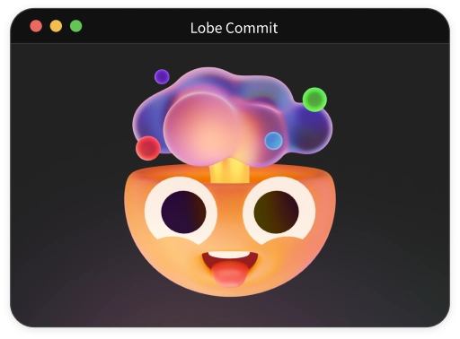

<div align="center"><a name="readme-top"></a>




<h1>Lobe SEO</h1>

Lobe SEO is a workflow tool that automates SEO Matter using ChatGPT.

English ・ [简体中文](./README.zh-CN.md) ・ [Changelog](./CHANGELOG.md) · [Report Bug][issues-url] · [Request Feature][issues-url]

<!-- SHIELD GROUP -->

[![][npm-release-shield]][npm-release-link]
[![][github-releasedate-shield]][github-releasedate-link]
[![][github-action-test-shield]][github-action-test-link]
[![][github-action-release-shield]][github-action-release-link]<br/>
[![][github-contributors-shield]][github-contributors-link]
[![][github-forks-shield]][github-forks-link]
[![][github-stars-shield]][github-stars-link]
[![][github-issues-shield]][github-issues-link]
[![][github-license-shield]][github-license-link]

</div>

<details>
<summary><kbd>Table of Contents</kbd></summary>

#### TOC

- [✨ Features](#-features)
- [📦 Installation](#-installation)
- [🤯 Usage](#-usage)
  - [AI Agent Skill](#ai-agent-skill)
  - [Configuration](#configuration)
  - [Environment Variables](#environment-variables)
- [🔍 Configuration](#-configuration)
  - [Running](#running)
- [⌨️ Local Development](#️-local-development)
- [🤝 Contributing](#-contributing)
- [🔗 Links](#-links)

####

</details>

## ✨ Features

- [x] 🤖 Automate SEO Matter using ChatGPT
- [x] ♻️ Support incremental SEO updates, automatically adding content for missing SEO information
- [x] 🛠️ Support custom OpenAI models, API proxies, temperature
- [x] 📝 Support `Markdown` `Mdx` SEO automation

<div align="right">

[![][back-to-top]](#readme-top)

</div>

## 📦 Installation

To install Lobe SEO, run the following command:

```bash
npm install -g @lobehub/seo-cli
```

> \[!IMPORTANT]\
> Make sure your environment has `Node.js` version **>= 22**

<div align="right">

[![][back-to-top]](#readme-top)

</div>

## 🤯 Usage

To initialize Lobe i8n configuration, run the following command:

```shell
$ lobe-seo -o # or use the full flag --option
```

> \[!IMPORTANT]\
> To use AI auto-generation, run `lobe-seo -o` to pick a provider, API protocol, base URL, API key and model, or set the `LOBE_*` environment variables below.

```shell
# Translate Locale files
$ lobe-seo

# Specify a configuration file
$ lobe-seo -c './custom-config.js' # or use the full flag --config
```

<br/>

### AI Agent Skill

Install the `lobe-seo` skill so coding agents (Claude Code, Cursor, Codex, Copilot...) know how to use it:

```shell
$ lobe-seo skill                # project: .agents/skills, plus .claude/skills if .claude exists
$ lobe-seo skill --global       # home directory
$ lobe-seo skill --agent claude # only .claude/skills (agents / claude)
```

Configs written by older versions are migrated automatically the next time any `lobe-seo` command runs.

<br/>

### Configuration

You can choose any configuration method in [cosmiconfig](https://github.com/cosmiconfig/cosmiconfig) format

- `seo` property in `package.json`
- `.seorc` file in JSON or YAML format
- `.seorc.json`, `.seorc.yaml`, `.seorc.yml`, `.seorc.js`, `.seorc.cjs` files

> \[!TIP]
>
> This project provides a `defineConfig` secure definition method that can be imported from `@lobehub/seo-cli`

<br/>

### Environment Variables

Some additional configurations are provided in this project, set using environment variables:

| Environment Variable | Required | Description                                                                                                                                                                                                              | Example                                                                   |
| -------------------- | -------- | ------------------------------------------------------------------------------------------------------------------------------------------------------------------------------------------------------------------------ | ------------------------------------------------------------------------- |
| `LOBE_PROVIDER`      | No       | Provider preset, overrides `lobe-seo --option`: `openai` `anthropic` `google` `deepseek` `qwen` `moonshot` `zhipu` `minimax` `openrouter` `siliconflow` `volcengine` `groq` `xai` `mistral` `ollama` `lmstudio` `custom` | `deepseek`                                                                |
| `LOBE_API_TYPE`      | No       | API protocol: `chat-completions` (`/v1/chat/completions`), `responses` (`/v1/responses`), `anthropic` (`/v1/messages`), `gemini`                                                                                         | `anthropic`                                                               |
| `LOBE_BASE_URL`      | No       | API base URL                                                                                                                                                                                                             | `https://api.deepseek.com/anthropic`                                      |
| `LOBE_API_KEY`       | No       | API key. Presets also read their own variable, e.g. `ANTHROPIC_API_KEY` `GEMINI_API_KEY` `DEEPSEEK_API_KEY` `DASHSCOPE_API_KEY` `OPENROUTER_API_KEY`. Not needed for `ollama` / `lmstudio`                               | `sk-xxxxxx...xxxxxx`                                                      |
| `OPENAI_API_KEY`     | No       | Legacy: used with `OPENAI_PROXY_URL` when no provider is configured (OpenAI Chat Completions compatible)                                                                                                                 | `sk-xxxxxx...xxxxxx`                                                      |
| `OPENAI_PROXY_URL`   | No       | Legacy: OpenAI compatible base URL                                                                                                                                                                                       | `https://api.chatanywhere.cn/v1`<br/>Default: `https://api.openai.com/v1` |

<div align="right">

[![][back-to-top]](#readme-top)

</div>

## 🔍 Configuration

| Property Name  | Required | Type           | Default Value    | Description                                                                                              |
| -------------- | -------- | -------------- | ---------------- | -------------------------------------------------------------------------------------------------------- |
| entry          | `*`      | `string`       | -                | Entry file or folder                                                                                     |
| entryExtension |          | `string`       | `.mdx`           | Entry file extension                                                                                     |
| groupKey       |          | `string`       | -                | Set group key for SEO matters                                                                            |
| tagStringify   |          | `boolean`      | `false`          | Stringify the tags array                                                                                 |
| modelName      |          | `string`       | provider default | Overrides the model chosen by `lobe-seo --option`, e.g. `gpt-5-mini` `claude-sonnet-4-5` `deepseek-chat` |
| temperature    |          | `number`       | `0`              | Sampling temperature used                                                                                |
| reference      |          | `string`       | -                | Provide some rule for more accurate seo                                                                  |
| concurrency    |          | `number`       | `5`              | Number of concurrently pending promises returned                                                         |
| experimental   |          | `experimental` | `{}`             | Experimental features, see below                                                                         |

#### `experimental`

| Property Name | Required | Type      | Default Value | Description                                                                                                |
| ------------- | -------- | --------- | ------------- | ---------------------------------------------------------------------------------------------------------- |
| jsonMode      |          | `boolean` | `false`       | Enable GPT forced JSON output for stability improvement (only supported by new models after November 2023) |

<br/>

#### Example 1 `.seorc.js`

```js
const { defineConfig } = require('@lobehub/seo-cli');

module.exports = defineConfig({
  entry: './docs/**/*.mdx',
  modelName: 'gpt-3.5-turbo-1106',
  experimental: {
    jsonMode: true,
  },
});
```

#### Example 2 `.seorc.json`

```json
{
  "entry": "./docs/**/*.mdx",
  "experimental": {
    "jsonMode": true
  },
  "modelName": "gpt-3.5-turbo-1106"
}
```

#### Example 3 `package.json`

```json
{
  "...": "...",
  "seo": {
    "entry": "./docs/**/*.mdx",
    "modelName": "gpt-3.5-turbo-1106",
    "experimental": {
      "jsonMode": true
    }
  }
}
```

<div align="right">

[![][back-to-top]](#readme-top)

</div>

### Running

Automatically generate SEO files using the `lobe-seo` command:

```shell
$ lobe-seo
```

<div align="right">

[![][back-to-top]](#readme-top)

</div>

## ⌨️ Local Development

You can use Github Codespaces for online development:

[![][github-codespace-shield]][github-codespace-link]

Alternatively, you can clone the repository and run the following commands for local development:

[![][bun-shield]][bun-link]

```bash
$ git clone https://github.com/lobehub/lobe-cli-toolbox.git
$ cd lobe-cli-toolbox
$ bun install
$ cd packages/lobe-seo
$ bun dev
```

<div align="right">

[![][back-to-top]](#readme-top)

</div>

## 🤝 Contributing

We welcome contributions in all forms. If you are interested in contributing code, you can check out our GitHub [Issues][github-issues-link], showcase your creativity, and share your ideas with us.

[![][pr-welcome-shield]][pr-welcome-link]

[![][github-contrib-shield]][github-contrib-link]

<div align="right">

[![][back-to-top]](#readme-top)

</div>

## 🔗 Links

- **[LobeHub](https://github.com/lobehub/lobehub)**
- **[lobe ui](https://github.com/lobehub/lobe-ui)**
- **[lobe icons](https://github.com/lobehub/lobe-icons)**
- **[lobe charts](https://github.com/lobehub/lobe-charts)**
- **[lobe editor](https://github.com/lobehub/lobe-editor)**
- **[docs kit](https://github.com/lobehub/docs-kit)**
- **[stream down](https://github.com/lobehub/streamdown)**

<div align="right">

[![][back-to-top]](#readme-top)

</div>

---

#### 📝 License

Copyright © 2023 [LobeHub][profile-link]. <br />
This project is licensed under [MIT](./LICENSE).

<!-- LINK GROUP -->

[back-to-top]: https://img.shields.io/badge/-BACK_TO_TOP-151515?style=flat-square
[bun-link]: https://bun.sh
[bun-shield]: https://img.shields.io/badge/-speedup%20with%20bun-black?logo=bun&style=for-the-badge
[github-action-release-link]: https://github.com/lobehub/lobe-cli-toolbox/actions/workflows/release.yml
[github-action-release-shield]: https://img.shields.io/github/actions/workflow/status/lobehub/lobe-cli-toolbox/release.yml?label=release&labelColor=black&logo=githubactions&logoColor=white&style=flat-square
[github-action-test-link]: https://github.com/lobehub/lobe-cli-toolbox/actions/workflows/test.yml
[github-action-test-shield]: https://img.shields.io/github/actions/workflow/status/lobehub/lobe-cli-toolbox/test.yml?label=test&labelColor=black&logo=githubactions&logoColor=white&style=flat-square
[github-codespace-link]: https://codespaces.new/lobehub/lobe-cli-toolbox
[github-codespace-shield]: https://github.com/codespaces/badge.svg
[github-contrib-link]: https://github.com/lobehub/lobe-cli-toolbox/graphs/contributors
[github-contrib-shield]: https://contrib.rocks/image?repo=lobehub%2Flobe-cli-toolbox
[github-contributors-link]: https://github.com/lobehub/lobe-cli-toolbox/graphs/contributors
[github-contributors-shield]: https://img.shields.io/github/contributors/lobehub/lobe-cli-toolbox?color=c4f042&labelColor=black&style=flat-square
[github-forks-link]: https://github.com/lobehub/lobe-cli-toolbox/network/members
[github-forks-shield]: https://img.shields.io/github/forks/lobehub/lobe-cli-toolbox?color=8ae8ff&labelColor=black&style=flat-square
[github-issues-link]: https://github.com/lobehub/lobe-cli-toolbox/issues
[github-issues-shield]: https://img.shields.io/github/issues/lobehub/lobe-cli-toolbox?color=ff80eb&labelColor=black&style=flat-square
[github-license-link]: https://github.com/lobehub/lobe-cli-toolbox/blob/master/LICENSE
[github-license-shield]: https://img.shields.io/github/license/lobehub/lobe-cli-toolbox?color=white&labelColor=black&style=flat-square
[github-releasedate-link]: https://github.com/lobehub/lobe-cli-toolbox/releases
[github-releasedate-shield]: https://img.shields.io/github/release-date/lobehub/lobe-cli-toolbox?labelColor=black&style=flat-square
[github-stars-link]: https://github.com/lobehub/lobe-cli-toolbox/network/stargazers
[github-stars-shield]: https://img.shields.io/github/stars/lobehub/lobe-cli-toolbox?color=ffcb47&labelColor=black&style=flat-square
[issues-url]: https://github.com/canisminor1990/lobe-commit/issues/new/choose
[npm-release-link]: https://www.npmjs.com/package/@lobehub/seo-cli
[npm-release-shield]: https://img.shields.io/npm/v/@lobehub/seo-cli?color=369eff&labelColor=black&logo=npm&logoColor=white&style=flat-square
[pr-welcome-link]: https://github.com/lobehub/lobe-cli-toolbox/pulls
[pr-welcome-shield]: https://img.shields.io/badge/%F0%9F%A4%AF%20PR%20WELCOME-%E2%86%92-ffcb47?labelColor=black&style=for-the-badge
[profile-link]: https://github.com/lobehub
